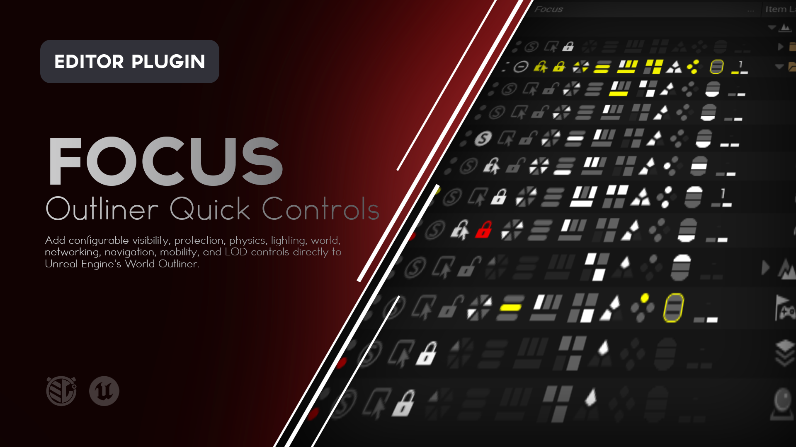
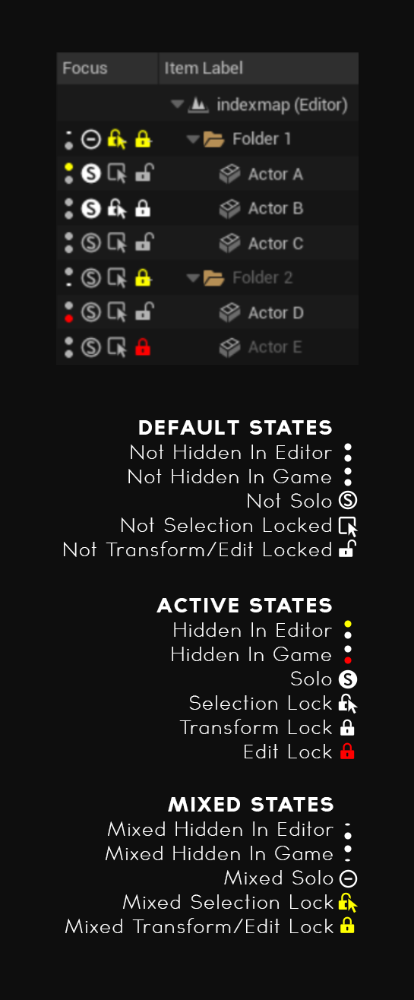
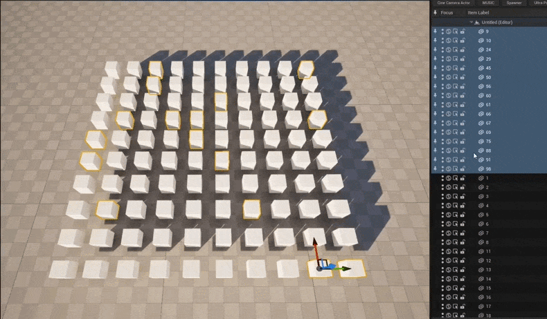
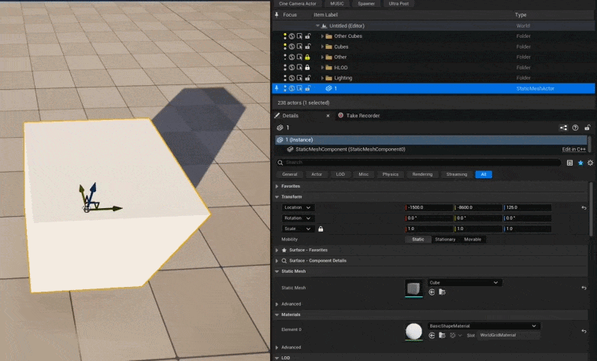

# Focus

**Outliner Quick Controls**

Focus brings frequently used Actor and Component properties directly into Unreal Engine's **World Outliner**, with small, configurable, native-feeling controls. Hide or isolate Actors, protect them from accidental edits, and adjust physics, rendering, navigation, networking, world, mobility, and LOD options without opening each Actor's Details panel.

Control individual Actors or operate on supported folders, groups, attached hierarchies, and multi-selections. Focus is an **editor-only** utility, not a runtime or permissions system.




---

## What is Focus?

Focus is a compact set of **Outliner Quick Controls** for scene visibility, selection, edit protection, and frequently changed native properties. Every control lives alongside its corresponding Actor or hierarchy in Unreal Engine's World Outliner.

- Work quickly with **Hide in Editor**, **Hidden in Game**, and **Solo**.
- Prevent accidental viewport selection, Actor movement, and supported Details editing with **Selection Lock**, **Transform Lock**, and **Edit Lock**.
- Optionally expose **28 quick-property controls** across eight additional categories.
- Apply eligible operations across loaded Actors, folders, attachments, groups, and multi-selections, with Undo/Redo.
- Show only the categories you need. Customize the control colors to suit your editor layout.

---

# Features

### Configurable categories

Focus adds a column to Unreal Engine's World Outliner. Open the **three-dots (`...`) menu at the far right of the Focus column header** to choose which categories appear. Each category has a checkbox, and hovering it shows the category's purpose and a complete list of controls it contains. Changes take effect immediately and persist in your editor-per-project preferences without altering the level.

**Visual and Interaction are visible by default.** The other eight categories, **Simulation, Physics Events, Lighting, World, Network, Navigation, Mobility, and LOD**, are hidden by default. Existing visibility preferences remain intact when updating. The menu's **Reset to Visual + Interaction** button restores the default set. The category order is fixed.

Each category uses a distinct miniwidget:

| Category | Layout |
|---|---|
| Visual | Visibility controls and Solo icon |
| Interaction | Selection Lock and a three-level protection selector |
| Simulation | Six individually clickable triangles around a central opening, clockwise from the top |
| Physics Events | Three evenly stacked horizontal pills |
| Lighting | Three upright channel bars above one full-width shadow bar |
| World | Four equally sized squares in a two-by-two grid |
| Network | Three angular pieces arranged in a radial triangle |
| Navigation | Four circular controls arranged north, east, south, and west |
| Mobility | Three stacked sections of one vertical pill |
| LOD | A centered forced-LOD number above two culling bars |

Miniwidgets have separate hover and click targets for each option. Their geometry and spacing remain consistent as property states change. They fit Unreal's standard 20-unit Outliner rows and remain vertically centered at larger row heights, including those configured with Stem. The Focus column resizes to the visible categories, without leaving gaps for hidden ones.

Category spacing is intentionally compact around Simulation and Network: 4 units before Simulation, 7 after Simulation, 6 before Network, and 4 after Network. The original Visual-to-Interaction gap remains 3 units; all other existing spacing rules are preserved.

### State colors

Customize the Focus control colors in **Edit > Editor Preferences > Plugins > Focus**, under **Control State Colors**. This is separate from the Focus header menu: Editor Preferences changes how states *look*, while the header menu changes which *categories appear*.

| Setting | Default | Meaning |
|---|---|---|
| Enabled Color | White | A supported property is enabled or the mobility choice is selected |
| Disabled Color | `#616161` | A supported property is disabled or the mobility choice is not selected |
| Mixed Color | Yellow | Eligible values disagree within the current Actor, hierarchy, or selection |
| Not Applicable Color | `#242424` | No eligible, instance-editable property is available for this control |
| Alert Color | Red | Warnings such as out-of-range forced LOD values and supported strong-lock indicators |

All five colors are configurable and saved to editor user settings. The gray defaults are treated as sRGB when converted for Slate, so their appearance matches the specified values. Changing these colors never changes the underlying Actor or Component properties.

### Native quick property editing

Optional controls operate on Unreal Engine's **native Actor and Component properties**, not copies stored by Focus. Each miniwidget segment shows the current aggregate state of eligible loaded Actors and components. A Mixed state is displayed only when applicable properties disagree, and unavailable or non-instance-editable properties appear dark gray without affecting adjacent controls.

The complete control reference appears below under **World Outliner Controls**, organized by category. Each control uses its corresponding native Unreal property where an eligible, instance-editable target exists.

**Hover any miniwidget segment** for an explanation of what the property controls, its current state, eligible targets, usage instructions, and relevant restrictions. The category checkbox tooltips in the header are shorter overviews that list the available controls; the miniwidget tooltips explain individual properties in more detail.

Controls are available only when Unreal exposes the backing property as editable on the relevant placed Actor or Component. Focus uses native property setters or editor change notifications and transactions where supported. It does not silently change prerequisites to make an inapplicable property editable. Actors protected by Focus Edit Lock are skipped, and folder or selection operations apply only to currently loaded, eligible targets. A single Actor can contain several eligible components, so inspect the tooltip before making a bulk change.

---

### World Outliner Controls

Focus adds its controls directly to the standard World Outliner.

No additional editor window is required.

### Hide in Editor

Temporarily hide Actors from editor viewports without affecting their Hidden in Game state.

### Hidden in Game

Control Unreal's existing Hidden in Game property directly from the World Outliner.

### Solo

Temporarily isolate Actors, folders, or hierarchies while working in the editor.

### Selection Lock

Prevent Actors from being selected accidentally through the viewport while keeping them selectable through the World Outliner.

### Transform Lock

Protect Actor location, rotation, and scale while leaving other properties editable.

### Edit Lock

Protect supported Actor and Component editing while keeping their properties available for inspection.

### Simulation

Quickly manage physics behavior for eligible Actors and primitive components using six independently clickable segments in a radial ring:

- **Simulate Physics:** Enable or disable rigid-body physics simulation on eligible primitive components. Physics simulation also depends on compatible collision and mobility settings.
- **Enable Gravity:** Allow gravity to affect physics-simulated components. Enabling gravity does not automatically enable physics simulation.
- **Ignore Radial Impulse:** Prevent instantaneous radial impulses from affecting supported primitive components.
- **Ignore Radial Force:** Prevent ongoing radial forces from affecting supported primitive components, independently of radial impulses.
- **Apply Impulse on Damage:** Allow eligible primitive components to receive an impulse from supported damage events; this does not itself configure damage or start simulation.
- **Async Physics Tick Enabled:** Enable an Actor's asynchronous physics tick where supported; this is separate from its normal game-thread tick.

### Physics Events

Control physics event notifications with three stacked horizontal pills, from top to bottom:

- **Generate Hit Events:** Enable rigid-body collision hit notifications where the component's collision setup supports the relevant contacts.
- **Generate Overlap Events:** Enable overlap event generation, subject to the other object's collision responses and overlap settings.
- **Generate Wake Events:** Enable physics wake and sleep notifications for eligible primitive components taking part in physics simulation.

### Lighting

Adjust lighting interactions using three upper channel bars and a lower shadow bar:

- **Lighting Channel 0:** Include eligible lights and primitives in Channel 0 interactions.
- **Lighting Channel 1:** Include eligible lights and primitives in Channel 1 interactions.
- **Lighting Channel 2:** Include eligible lights and primitives in Channel 2 interactions.
- **Cast Shadows:** Enable or disable shadow casting on supported light or primitive components, subject to relevant rendering and material settings.

A light and a receiving primitive must have a compatible lighting channel for that channel to affect their interaction. Lighting channels do not override other lighting restrictions.

### World

Access four world-related Actor properties through a two-by-two grid:

- **In Main World Only:** Restrict a supported Actor to the main world where Unreal respects this setting.
- **Is Editor Only Actor:** Mark the Actor as editor-only so it is excluded from cooked gameplay content where supported. Check dependencies before enabling this on referenced Actors.
- **Is Spatially Loaded:** Control whether the Actor participates in World Partition spatial loading where applicable.
- **Include Actor in HLOD:** Control participation in automatic Hierarchical Level of Detail generation in supported worlds.

### Network

Manage three network-related properties through a triangular miniwidget:

- **Net Load on Client:** Control whether a placed Actor is loaded on clients as part of networked level loading. This does not enable Actor replication.
- **Replicate Physics to Autonomous Proxy:** Control physics-state replication to autonomous proxies on eligible primitive components. A suitable networking and physics setup is required.
- **Static Mesh Replicate Movement:** Control movement replication for supported Static Mesh Actors. It does not enable replication for unrelated Actor or component types.

### Navigation

Access four navigation settings through the four circular points of the navigation miniwidget:

- **Can Ever Affect Navigation (top):** Allow an eligible Actor component to contribute to navigation data.
- **Dynamic Obstacle (right):** Mark an eligible shape component as a dynamic navigation obstacle where supported.
- **Fill Collision Underneath for Navmesh (bottom):** Fill navigation data underneath eligible primitive collision according to the navmesh configuration.
- **Rasterize as Filled Convex Volume (left):** Use filled convex-volume rasterization for supported primitive collision when generating navigation data.

Changes to navigation settings may require appropriate collision geometry or navigation updates before their effects appear.

### Mobility

Set an eligible scene component's mobility with a single vertical pill divided into three sections:

- **Static (top):** Keep the component in the Static mobility mode.
- **Stationary (middle):** Choose Stationary mobility when supported by that component and its usage.
- **Movable (bottom):** Choose Movable mobility to allow dynamic movement where appropriate.

Click a section to assign that mobility to eligible components. The choices are mutually exclusive for each component. When the targets have different mobility values, the miniwidget shows a Mixed outline with neutral interior bands. Certain component types and lighting setups impose additional restrictions.

### LOD

Control mesh Level of Detail and distance culling from a forced-LOD number positioned above two horizontal bars:

- **Forced LOD Model (top number):** `0` uses automatic LOD. Positive values follow Unreal's one-based forced-LOD convention: `1` selects mesh LOD 0, `2` selects mesh LOD 1, and so on. The number supports **left-click to increment**, **Alt + left-click to decrement**, **mouse wheel** to adjust, and **double-click** to enter a value directly. The input range is 0 to 255, but each mesh may support fewer LODs. Invalid forced values use the Alert color (red by default) and are explained in the tooltip.
- **Never Distance Cull (first bar):** Prevent supported primitive components from being removed by distance-culling systems that honor this setting. This does not disable all visibility or streaming mechanisms.
- **Allow Cull Distance Volume (second bar):** Allow eligible primitive components to be influenced by Cull Distance Volumes in the level.

The two culling controls toggle independently. **Right-click** still opens the native Outliner context menu. Focus does not silently clamp an existing forced-LOD value to an available mesh LOD.

### Hierarchy Support

Apply Focus controls to:

- Individual Actors
    
- Attached Actor hierarchies
    
- Folders
    
- Nested folders
    
- Groups
    
- Nested groups
    

### Multi-Selection Support

Apply Focus controls across several selected Actors or folders at once.

### Mixed States

Focus indicates when a hierarchy contains a mixture of enabled and disabled states.

### Undo / Redo

Focus control changes participate in Unreal Engine's normal Undo and Redo workflow.

### Persistent Settings

Focus states can be saved with the affected Actor or level packages and restored later.

### Editor Only

Focus is an editor utility and does not add runtime systems to packaged builds.

---



---

# Using Focus

Focus works directly in the **World Outliner**. The standard layout keeps **Visual** and **Interaction** enabled; the eight optional quick-property categories are hidden until you choose to show them.

### Choose the controls you need

1. Open Unreal Engine's **World Outliner** and locate the Focus column.
2. Open the **`...` menu** at the far right of the Focus column header.
3. Hover over a category checkbox to read its purpose and see which individual controls it contains. Check the categories relevant to your work, such as **Simulation**, **Lighting**, **Network**, or **LOD**. The miniwidgets appear immediately in each applicable Outliner row.
4. To return to the initial layout, choose **Reset to Visual + Interaction** in the same menu. Category visibility is saved in your editor-per-project user preferences; it does not change level data.

### Read and change properties

1. Locate an Actor, folder, group, or supported hierarchy in the Outliner. You can also select multiple rows before using a Focus control.
2. Hover over the **individual miniwidget segment** you want to change. Its tooltip explains the native property, current value, eligible target count, and any known restrictions.
3. Check the segment's state: **white** means enabled, **gray** means disabled, **yellow** indicates Mixed values, and **dark gray** means Not Applicable. The actual colors are configurable.
4. Click an applicable segment to toggle that property on eligible loaded targets. A Mixed toggle is enabled across eligible targets when clicked. Edit-locked Actors are skipped. Changes participate in Unreal's normal Undo/Redo workflow where supported.
5. For **Mobility**, click the Static, Stationary, or Movable part of the vertical pill to choose that value. For **LOD**, click or scroll the upper number to adjust Forced LOD Model, use Alt + click to decrement, or double-click to type a value. Use the two lower bars to toggle culling properties separately.

Not every Actor has every property. For example, a physics setting may apply to an Actor's primitive components, a navigation setting may apply to a shape component, and a network setting may be limited to supported Actor classes. Unavailable controls remain visible but dark, rather than changing unrelated properties. Bulk operations affect currently loaded, eligible targets, not automatically all possible Actors in a world.

### Customize appearance

Open **Edit > Editor Preferences > Plugins > Focus** and expand **Control State Colors** to change the **Enabled**, **Disabled**, **Mixed**, **Not Applicable**, and **Alert** colors. These preferences affect the appearance of the widgets, not the native property values or the categories shown in the header menu.

### Example workflows

- **Working with physics:** Show Simulation and Physics Events, then use the six simulation segments and three event pills to inspect or change eligible component behavior without repeatedly opening Details panels.
- **Preparing scene lighting:** Show Lighting to inspect channel assignments and shadow casting across selected lights or primitives.
- **Reviewing streaming and replication:** Show World and Network to inspect supported Actor loading, HLOD, client loading, and replication properties.
- **Tuning traversal and visibility:** Show Navigation to inspect navmesh-affecting settings, or LOD to adjust the forced LOD and distance-culling properties on eligible meshes and components.

Save Actor or level packages normally when you want changes to persistent Actor properties or Focus states to be retained. Interface category visibility and appearance preferences are saved separately as editor user settings.

The detailed guides that follow cover the original Visual and Interaction controls first, then all eight optional property categories in the order they appear in the Focus header menu.

---

## Hide in Editor

The upper visibility control determines whether an Actor is hidden in editor viewports.

When enabled:

- The Actor is hidden while editing.
    
- Hidden in Game is not changed.
    
- The Actor can still remain part of the level.
    

Use this when something needs to be temporarily removed from view while working.

---

## Hidden in Game

The lower visibility control modifies Unreal's existing **Hidden in Game** property.

When enabled, the Actor is hidden during gameplay according to Unreal's normal runtime behavior.

This is separate from Hide in Editor.

That separation allows an Actor to be:

- Visible in the editor but hidden in game
    
- Hidden in the editor but visible in game
    
- Visible in both
    
- Hidden in both
    

---

## Solo

Solo isolates part of the level inside the editor viewport.

You can Solo:

- An Actor
    
- An Actor hierarchy
    
- A Folder
    
- Multiple Actors
    
- Multiple Folders
    
- Groups
    

Multiple Solo targets can be active simultaneously.

When Solo is cleared, normal editor visibility returns.

Solo does not change Hidden in Game.



### Solo and Existing Visibility

Actors already hidden using **Hide in Editor** remain hidden while Solo is active.

Solo should be treated as a temporary viewport isolation tool rather than a replacement for normal level visibility.

Lights, volumes, and other scene systems may continue influencing the viewport even when their Actor is outside the current Solo set.

---

## Selection Lock

Selection Lock prevents an Actor from being selected through the viewport.

When enabled:

- Clicking the Actor in the viewport will not select it.
    
- The Actor can still be selected from the World Outliner.
    
- Its properties can still be inspected.
    
- Selection Lock does not prevent editing by itself.
    

This is useful for Actors such as:

- Large background meshes
    
- Blocking geometry
    
- Lighting Actors
    
- Reference geometry
    
- Level infrastructure
    
- Anything that frequently sits in front of what you actually want to select
    

---

## Transform Lock

Transform Lock protects an Actor's:

- Location
    
- Rotation
    
- Scale
    

Other properties remain editable.

Focus uses native Actor movement locking and a movement/transaction guard rather than replacing Unreal's viewport transform gizmo. The same Focus controls are available while using Unreal Engine's legacy or Interactive Tools Framework (ITF) gizmo system.

This is useful when an Actor is in the correct place but still needs to remain otherwise editable.

---

## Edit Lock

Edit Lock provides stronger protection.

It includes Transform Lock and protects supported Actor and Component editing operations.

This includes common workflows such as:

- Editing values in the Details panel
    
- Changing transforms
    
- Changing mobility
    
- Changing materials
    
- Renaming
    
- Deleting
    
- Cutting
    
- Changing attachments
    
- Adding Components
    
- Removing Components
    

The Actor can still be selected from the World Outliner and inspected.

You can continue to:

- Browse properties
    
- Search the Details panel
    
- Expand and collapse categories
    
- Inspect values
    
- Change Focus states
    

The purpose is to prevent accidental editing while still allowing developers to understand the Actor.

---

## Protection Lock States

The protection control cycles through:

```text
Unlocked → Transform Lock → Edit Lock → Unlocked
```

The visual state of the padlock indicates the current protection level.



## Simulation

The **Simulation** miniwidget exposes six physics-related controls in a radial arrangement. Enable it from the Focus header menu when working with physics Actors, destructible scene elements, or other components that may react to forces. Each triangular piece is independent, so changing gravity does not also change physics simulation, for example.

### Physics simulation and gravity

**Simulate Physics** allows an eligible primitive component to be driven by rigid-body physics instead of relying solely on its authored transform. A component needs appropriate collision and mobility settings for simulation to behave as expected. If a component cannot be edited through Focus, its segment is shown as Not Applicable; Focus does not silently change those prerequisites.

**Enable Gravity** determines whether world gravity influences an eligible component while it is simulating physics. You can enable gravity without enabling simulation, but gravity will not by itself make a non-simulating component fall.

For example, when preparing a collection of movable props, use the Simulate Physics segment to enable physics on eligible components and the Gravity segment to decide which props should fall under world gravity.

### Radial impulses, forces, and damage

**Ignore Radial Impulse** makes a component ignore supported instantaneous radial impulses, such as a burst of outward force. **Ignore Radial Force** instead applies to ongoing radial force effects. These are separate settings: disabling one type of response does not disable the other.

**Apply Impulse on Damage** permits supported damage events to impart a physical impulse. This option does not automatically configure damage handling, collision, or physics simulation.

A useful workflow is to select the Actors surrounding an explosion effect, inspect their radial impulse and force settings, and change only the response you want to suppress.

### Async physics ticking

**Async Physics Tick Enabled** is an Actor-level option. It controls whether Unreal may invoke the Actor's asynchronous physics tick where supported; it is not an alternative switch for Simulate Physics or the regular Actor tick.

The widget may therefore show different applicability for this segment than for the component-level physics segments. Hover each piece to see which targets Focus can actually edit.

---

## Physics Events

The **Physics Events** miniwidget has three horizontally stacked pills. From top to bottom, they control **Generate Hit Events**, **Generate Overlap Events**, and **Generate Wake Events**. Use it when checking why collision or simulation events are or are not being produced by a component.

### Hit events versus overlap events

**Generate Hit Events** controls rigid-body collision hit notifications for eligible primitive components. A hit event still depends on collision setup and the type of contact involved; this checkbox alone does not guarantee that every collision produces an event.

**Generate Overlap Events** controls overlap notification generation. Overlap behavior also depends on the other object, both collision configurations, and whether their responses permit overlaps. An overlap is not the same thing as a blocking hit.

For example, a blocking wall and a trigger volume typically require different event setups. The two upper pills let you inspect the intended event type without navigating between Details panels.

### Wake events

**Generate Wake Events**, the bottom pill, controls supported physics wake and sleep notifications. These are associated with physics-body activity, rather than ordinary actor visibility or overlap changes. An applicable physics simulation setup is needed for meaningful wake/sleep events.

Each pill reflects its own value. A mixed selection can show Mixed for overlap events while hit and wake events remain uniformly enabled or disabled. Enabling event generation in Focus does not automatically create Blueprint or C++ handlers for the resulting events.

---

## Lighting

The **Lighting** miniwidget groups four independent properties. Its **three upright upper bars** are Lighting Channels **0**, **1**, and **2**, from left to right. The **lower horizontal bar** controls **Cast Shadows**.

### Lighting channels

Lighting channels help determine which eligible lights can interact with which eligible primitives. For a light to affect a primitive through this mechanism, both need compatible channel assignments, and the normal rendering rules must still permit the interaction.

You can use the upper bars to check or change channels on supported light and primitive components. Focus changes the selected channel without intentionally resetting the other two channels. For example, you might place a set of character meshes on Channel 1 and assign a dedicated light to that same channel while leaving ordinary environment lighting on Channel 0.

The individual channel controls can show different states within a multi-selection. Hover a bar to confirm its channel and target eligibility before toggling it.

### Cast Shadows

The bottom bar toggles the corresponding **Cast Shadows** property on eligible components. A component's final shadow behavior also depends on its material, lighting type, and render configuration. Turning this on does not override those other requirements.

This category is useful for checking channel assignments and shadow casting across a group of supported objects without repeatedly opening their individual Details panels.

---

## World

The **World** miniwidget displays four Actor-level settings in a **two-by-two grid**. Unlike categories that operate on component properties, these controls apply to an Actor's own world-related flags.

### Main-world and editor-only behavior

The **top-left square**, **In Main World Only**, controls the corresponding main-world restriction where Unreal supports it. It does not otherwise change which level or folder contains the Actor.

The **top-right square**, **Is Editor Only Actor**, marks the Actor as editor-only where the engine honors that flag. Editor-only Actors can be excluded from cooked gameplay content, so use this carefully if other gameplay objects reference the Actor. Hiding something in the editor is not the same as marking it editor-only.

### World Partition and HLOD

The **bottom-left square**, **Is Spatially Loaded**, controls eligibility for World Partition spatial loading. Its effect depends on whether the world uses World Partition and how the world is configured. Changing the flag does not itself load every cell or alter unloaded Actors.

The **bottom-right square**, **Include Actor in HLOD**, controls participation in supported Hierarchical Level of Detail generation. This does not immediately build new HLODs. The world must have an applicable HLOD setup and generation workflow.

When preparing a large World Partition level, use the bottom two squares to review spatial loading and HLOD participation across loaded Actors. The four settings remain independent, and only eligible, instance-editable Actor properties can be changed.

---

## Network

The **Network** miniwidget contains three separately clickable angular pieces arranged around a center. These controls relate to different parts of Unreal's networking behavior and should not be treated as a single Replication On/Off switch.

### Client loading

**Net Load on Client**, the upper piece, determines whether a placed Actor is eligible to load on clients as part of the relevant networked level-loading behavior. **It does not, by itself, enable Actor replication.** A level-placed Actor loading on a client and a server replicating its state are separate concerns.

### Physics and movement replication

**Replicate Physics to Autonomous Proxy**, the lower-left piece, controls the corresponding physics replication setting on supported primitive components. Its effect requires the appropriate physics and network configuration; it cannot make an otherwise unsupported component replicate its physics automatically.

**Static Mesh Replicate Movement**, the lower-right piece, exposes the corresponding movement-replication setting for supported Static Mesh Actors. It is not a universal toggle for movement replication on every Actor type.

For example, when reviewing networked moving props, check the movement piece on eligible Static Mesh Actors and the physics piece on relevant primitives. A dark Not Applicable piece often indicates a different Actor or component class, not that networking has been globally turned off.

---

## Navigation

The **Navigation** miniwidget uses a diamond of **four circular controls**. Its compass-like arrangement provides four distinct properties, with larger invisible click regions than the dots themselves.

### Navigation contribution and dynamic obstacles

The **top circle**, **Can Ever Affect Navigation**, controls whether an eligible Actor component may contribute to navigation data. Navigation geometry, collision settings, and rebuild behavior still determine the outcome.

The **right circle**, **Dynamic Obstacle**, marks supported shape components as dynamic navigation obstacles. This may not be available on ordinary components that do not expose the corresponding property.

For example, you can inspect whether a placed obstacle component is allowed to influence navigation before investigating a missing or unexpected navmesh cutout.

### Navmesh collision treatment

The **bottom circle**, **Fill Collision Underneath for Navmesh**, controls how supported primitive collision fills the navigation representation beneath it, subject to the navmesh configuration.

The **left circle**, **Rasterize as Filled Convex Volume**, uses filled convex-volume rasterization for eligible primitive collision during navigation generation.

The four controls affect the input or behavior of navigation generation; they do not replace navmesh volumes, agent settings, collision setup, or navigation rebuilding. When a change does not immediately alter navigation, check those other systems rather than assuming the Focus toggle failed.

---

## Mobility

The **Mobility** miniwidget is a single upright pill divided into **Static**, **Stationary**, and **Movable** sections, from top to bottom. Unlike the independent switches in most other categories, these three positions are **mutually exclusive choices for one native component property**.

### Selecting a mobility mode

**Static** is intended for components that are not expected to move during play. **Stationary** represents a limited-movement mode where supported, often relevant to particular rendering or lighting configurations. **Movable** allows the component to move dynamically, subject to its class and other engine rules.

Click the corresponding third of the pill to assign that mobility mode to eligible Scene Components. Selecting Movable does not automatically enable physics simulation, and selecting Static does not automatically lock an Actor against editor edits. Focus's Transform Lock and Edit Lock are separate controls.

### Reading mixed and unavailable states

When eligible components disagree on their mobility settings, the entire pill shows a **Mixed-colored outline** with neutral interior bands. It does not pretend one of the three modes is selected for the whole scope. When values agree, the selected band uses the Enabled color and the others use the Disabled color.

If no editable component property exists, the control is Not Applicable. Some component types also have restrictions on available mobility modes. Use the tooltip and the native Details panel to inspect restrictions before attempting bulk mobility changes.

---

## LOD

The **LOD** miniwidget combines one numeric control with two independent culling switches. The **upper number** is **Forced LOD Model**; the **two lower bars** are **Never Distance Cull** and **Allow Cull Distance Volume**.

### Forced LOD Model

A value of **`0`** means automatic LOD selection. Positive values use Unreal's **one-based forced-LOD convention**: **`1`** forces mesh LOD 0, **`2`** forces mesh LOD 1, and so on. The number applies to eligible static or skinned mesh components, not to every possible Actor type.

You can operate the number without opening another editor:

- **Left-click** to increment it by one.
- **Alt + left-click** to decrement it by one.
- **Mouse wheel** over the number to adjust it.
- **Double-click** to open the numeric editor and enter a value directly.

The editor accepts values from **0 to 255**, but a particular mesh may contain fewer LODs than the value requests. In that case, Focus retains the native value and displays an **Alert-colored warning** instead of silently selecting a different LOD. Hover the number for its current value and applicable range.

### Distance culling

**Never Distance Cull**, the first lower bar, prevents eligible primitives from being removed by supported distance-culling systems that honor the setting. It does not override all visibility, HLOD, or World Partition behavior.

**Allow Cull Distance Volume**, the second lower bar, permits an eligible primitive to be influenced by Cull Distance Volumes. A suitable volume and level setup must exist before the setting can affect rendering.

A useful workflow is to select several meshes, adjust their forced LOD for a visual review, then return the number to `0` for automatic selection. Set the two culling bars separately according to the intended distance behavior. **Right-click** on the widget continues to use the native Outliner context menu.

---

# Working with Folders and Hierarchies

Focus controls are designed to work beyond individual Actors.

Applying a Focus control to a hierarchy can affect everything represented by that hierarchy.

|Target|Affected Scope|
|---|---|
|**Actor**|The Actor and attached descendants|
|**Folder**|Loaded Actors inside the Folder and nested Folders|
|**Group**|The Group, its members, and nested Groups|
|**Multiple Selection**|The combined scope of all selected rows|

Collapsed Outliner rows are still included.

Outliner search filters do not prevent matching Actors from being included in the operation.

This makes it possible to manage large sections of a level without expanding every hierarchy first.

---

# Working with Multiple Actors

If several rows are selected in the World Outliner, activating a Focus control from one of those selected rows applies that action across the combined selection.

This is useful for:

- Soloing several unrelated Actors
    
- Locking a group of finished environment pieces
    
- Hiding several folders
    
- Protecting a set of important Actors
    
- Changing several hierarchy states at once
    

For normal toggle controls:

- Clicking an **off** state enables it.
    
- Clicking a **mixed** state enables it across the complete scope.
    
- Clicking a **fully enabled** state disables it.
    

---

# Mixed States

Folders and selections can contain Actors with different Focus settings.

Focus represents this using a mixed state.

For example:

```text
Environment
├── Wall_A        Transform Locked
├── Wall_B        Transform Locked
└── Door          Unlocked
```

The protection control for the `Environment` Folder will show that its contents do not all share the same state.

This makes it easier to understand the actual state of a hierarchy without expanding and inspecting every Actor individually.

---

# Example Workflow

Imagine you're working in a dense environment that contains finished architecture, temporary gameplay objects, lights, reference meshes, and the section you're currently editing.

You could:

1. **Selection Lock** large background geometry so it stops intercepting viewport clicks.
    
2. **Transform Lock** finished architecture so it cannot be nudged accidentally.
    
3. **Edit Lock** important Actors that should only be inspected.
    
4. **Solo** the Folder you're actively working on.
    
5. Clear Solo when the work is complete.
    

The level structure remains unchanged while the editor becomes much easier to navigate safely.

---

# Saving Focus Settings

There are two different kinds of persistence:

- **Header visibility and Editor Preferences colors:** saved as editor-per-project user preferences. They customize your own Focus interface, not the Actors or levels shared with teammates.
- **Actor settings:** Focus Visual and Interaction states can be stored with Actor or level packages as described below; native quick properties persist through Unreal's normal Actor and Component property serialization.

Focus states can persist between:

- Level reloads
    
- Unreal Editor sessions
    
- Source-control syncs
    

After changing persistent Focus settings, save the affected Actor or level packages using your normal Unreal workflow.

The following Focus states can be stored:

- Selection Lock
    
- Transform Lock
    
- Edit Lock
    
- Solo
    
- Hide in Editor
    

Hidden in Game uses Unreal Engine's existing Actor property.

For projects using External Actors / One File Per Actor, Focus metadata is stored with the relevant Actor package.

Otherwise, it is typically stored with the level package.

> [!WARNING]  
> **Solo and Hide in Editor can also be saved.**
> 
> If you only intended to use them temporarily, clear those states before saving.

---

# Installation

Focus can be installed through **Fab**, from a **precompiled GitHub Release**, or directly from the **GitHub source**.

For most users, the Fab or GitHub Release installation is recommended.

---

## Fab / Epic Games Launcher

> Use this method if Focus is available in your Fab library.

1. Add **Focus** to your library on Fab.
    
2. Open the **Epic Games Launcher**.
    
3. Navigate to your Unreal Engine Library.
    
4. Locate Focus in your Fab / Vault library.
    
5. Install Focus to the supported Unreal Engine version.
    
6. Launch your Unreal Engine project.
    
7. Open **Edit > Plugins**.
    
8. Search for **Focus**.
    
9. Enable the plugin if it is not already enabled.
    
10. Restart Unreal Editor if prompted.
    

Once enabled, Focus controls will appear in the World Outliner.

---

## GitHub Release

This is the easiest GitHub installation method because the release package is already prepared for the supported Unreal Engine version.

### 1. Download Focus

Open the repository's **Releases** page:

[https://github.com/mippi-the-dork/Focus/releases](https://github.com/mippi-the-dork/Focus/releases)

Download the latest package matching your Unreal Engine version and platform.

For example:

```text
Focus-vX.Y.Z-UE5.8.x-Win64.zip
```

### 2. Close Unreal Editor

Close the project before installing the plugin.

### 3. Locate Your Project Plugins Folder

Your project should contain a `Plugins` directory beside the `.uproject` file:

```text
YourProject/
├── Config/
├── Content/
├── Plugins/
└── YourProject.uproject
```

If the `Plugins` directory does not exist, create it.

### 4. Extract Focus

Extract the `Focus` folder into:

```text
YourProject/Plugins/
```

The final structure should look similar to:

```text
YourProject/
├── Plugins/
│   └── Focus/
│       ├── Config/
│       ├── Resources/
│       ├── Source/
│       └── Focus.uplugin
└── YourProject.uproject
```

### 5. Launch the Project

Open your Unreal Engine project.

If necessary, navigate to:

**Edit > Plugins**

Search for:

```text
Focus
```

Enable the plugin and restart Unreal Editor if prompted.

---

## GitHub Source

Developers who want the latest source or want to modify Focus can clone the repository directly.

### Requirements

Building Focus from source requires a working Unreal Engine C++ development environment.

For Windows this generally means:

- Unreal Engine 5.8.x
    
- Visual Studio with the appropriate C++ workloads
    
- A project capable of compiling C++ plugins
    

### Clone the Repository

Close Unreal Editor and navigate to your project's `Plugins` directory.

```bash
cd YourProject/Plugins
git clone https://github.com/mippi-the-dork/Focus.git
```

Your project should now contain:

```text
YourProject/Plugins/Focus/
```

### Generate Project Files

If necessary:

1. Right-click your `.uproject`.
    
2. Select **Generate Visual Studio project files**.
    

Then open the generated solution and build your project's Editor target.

For example:

```text
YourProjectEditor
Win64
Development Editor
```

Launch the project after compilation completes.

---

# Updating Focus

## GitHub Release Installation

When updating a manually installed release:

1. Close Unreal Editor.
    
2. Remove the existing `Plugins/Focus` folder.
    
3. Extract the new Focus release into the `Plugins` directory.
    
4. Reopen the project.
    

Replacing the complete plugin folder is recommended rather than copying individual files over an older version.

## Git Source Installation

If you cloned the repository using Git:

```bash
cd YourProject/Plugins/Focus
git pull
```

Rebuild the project if the source has changed.

---

# Compatibility

Focus supports the following target configuration:

|||
|---|---|
|**Focus Version**|2.0.2|
|**Unreal Engine**|5.8.x|

|**Platform**|Windows 64-bit|
|**Plugin Type**|Editor|
|**Runtime Dependency**|None|
|**Packaged Game Impact**|None|

Focus is currently configured as a Win64 editor plugin.

Compatibility with additional Unreal Engine versions or platforms should not be assumed unless explicitly listed in a release.

---

# How Focus Works

Focus extends Unreal Engine's World Outliner with additional editor controls.

When a Focus control is used:

1. Focus determines the Actor, Folder, Group, hierarchy, or multi-selection represented by the clicked row.
    
2. The relevant Actor scope is resolved.
    
3. The selected Focus state is applied to the affected Actors.
    
4. Unreal's normal transaction system records supported changes for Undo and Redo.
    
5. Persistent Focus states can be stored with the affected Actor or level packages.
    

Focus protection operates entirely inside the editor.

Selection Lock and Delete/Cut protection are handled by the Focus editor mode. Transform Lock and Edit Lock use Unreal's native movement-lock behavior together with Focus's transform and property-change guards. Focus does not require the legacy editor-mode viewport-input interface, so its editor mode does not force Unreal Engine to disable Interactive Tools Framework (ITF) gizmos.

Focus does not replace or configure Unreal's transform gizmo, and its editor protections depend on the editing operation using supported engine notifications. Specialized tools can operate outside those paths, as described in **Limitations**.

Focus does not add gameplay components or runtime systems to the packaged game.

---

# What Focus Does Not Do

Focus is an **editor workflow utility**, not a permissions or security system.

It does not:

- Prevent deliberate source-code changes
    
- Prevent scripts from modifying Actors
    
- Replace source control
    
- Implement user permissions
    
- Automatically check out files
    
- Prevent another developer from unlocking something
    
- Modify packaged game behavior
    
- Automatically apply Folder states to Actors added later
    

Focus is intended to prevent accidental editor interactions and make complex scenes easier to manage.

---

# Limitations

### Newly Added Actors

Focus Folder and hierarchy operations affect the Actors currently contained within that scope.

They are not inheritance rules.

If another Actor is added to a Folder later, apply the Focus state again if you want the new Actor included.

### World Partition

Bulk operations affect loaded Actors.

Unloaded World Partition Actors are not modified.

Load the required Actors before performing a bulk Focus operation.

### Selection Lock

Selection Lock prevents normal viewport selection.

The Actor remains intentionally selectable through the World Outliner so it can be inspected or unlocked.

### Edit Lock

Edit Lock protects supported standard editor workflows.

Specialized editor tools, scripts, custom editor systems, or direct engine operations may provide ways to modify an Actor outside those guarded workflows.

### Solo

Solo primarily isolates rendered primitive components.

Some scene contributions, such as lighting or volumes, may continue affecting the viewport even when their Actor is outside the Solo set.

---

# Troubleshooting

## Focus Does Not Appear in the World Outliner

Check:

**Edit > Plugins**

Search for:

```text
Focus
```

Confirm that the plugin is enabled.

Restart Unreal Editor if the plugin was just enabled.

---

## A Focus Setting Did Not Persist

Make sure the affected Actor or level package was saved after changing the Focus state.

Use:

**File > Save All**

or your normal project save workflow.

---

## A Folder Did Not Affect an Actor

Check whether:

- The Actor is currently loaded.
    
- The Actor was added after the Focus state was applied.
    
- World Partition currently has the Actor unloaded.
    

Folder operations are bulk actions rather than persistent inheritance rules.

---

## Hidden in Game Cannot Be Changed

Check whether the Actor currently has **Edit Lock** enabled.

Hidden in Game modifies an Actor property, so Edit Lock protects it from being changed.

---

## A Selection-Locked Actor Can Still Be Selected

Selection Lock prevents **viewport selection**.

The Actor is intentionally still selectable from the World Outliner.

---

## A Script Changed a Locked Actor

Focus protects against supported manual editor interactions.

Scripts, custom tools, and direct engine operations can still modify Actors.

---

# Reporting Bugs

If you encounter a problem, please open an issue:

[https://github.com/mippi-the-dork/Focus/issues](https://github.com/mippi-the-dork/Focus/issues)

When reporting a bug, include:

- Focus version
    
- Unreal Engine version
    
- Windows version
    
- Whether Focus was installed from Fab, a GitHub Release, or source
    
- The Focus control involved
    
- Whether the target was an Actor, Folder, Group, or multi-selection
    
- Whether World Partition was involved
    
- Steps to reproduce the problem
    
- Screenshots or video when relevant
    
- Any relevant Unreal Editor log output
    

Clear reproduction steps make issues much easier to diagnose.

---

# Feature Requests

Suggestions and feature requests are welcome through GitHub Issues.

When proposing a feature, describe the workflow problem you're trying to solve rather than only the implementation you would like to see.

That makes it easier to determine whether the feature belongs in Focus and whether there may be a simpler solution.

---

# Contributions

Pull requests are welcome.

If you're considering a significant change, opening an Issue first is recommended so the direction can be discussed before substantial work is done.

Focus concentrates frequently used Actor and Component settings into optional Outliner categories, while preserving the compact Visual and Interaction defaults.

---

# License

Focus is distributed under the **MIT License**.

See the [repository license](https://github.com/mippi-the-dork/Focus/blob/main/LICENSE) for details.

---

# About

Focus is an Unreal Engine editor utility created by **Mippi the Dork**.

The plugin was built around a simple workflow problem:

> As levels grow in complexity, the tools used to manage them should become faster, more accessible, and more intuitive.

Focus brings frequently used Actor and Component properties directly into the **World Outliner**, turning it into a more powerful workspace for managing visibility, interaction, physics, lighting, networking, navigation, mobility, LOD, and other essential editor operations.

Through compact, configurable miniwidgets, Focus makes these controls immediately accessible without constantly navigating the Details panel. Users can customize which categories appear, adjust their visual appearance, and apply supported operations across individual Actors, folders, hierarchies, and multi-selections.

**Focus is designed to make complex scenes easier to manage, repetitive adjustments faster to perform, and everyday Unreal Engine workflows more efficient, all without leaving the World Outliner.**

