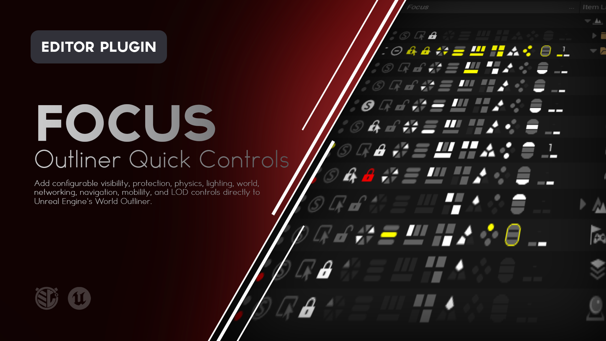
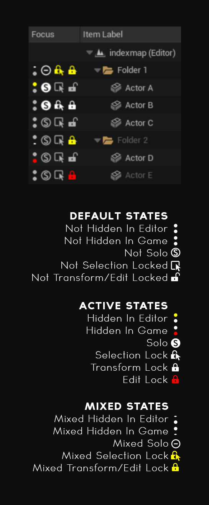
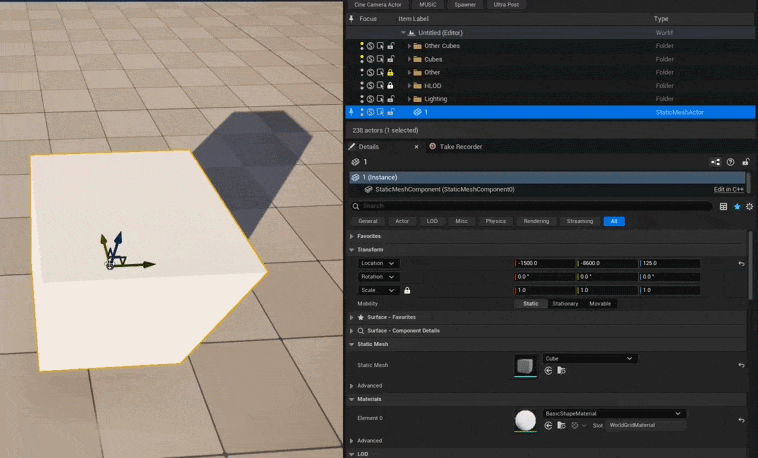
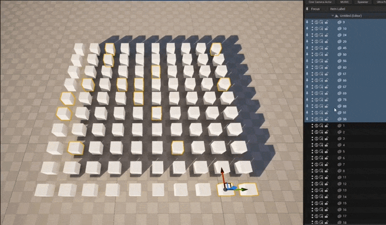

# Focus

**Outliner Quick Controls for Unreal Engine**

**Spend less time hunting through Details panels. Spend more time building your level.**

Focus brings frequently used visibility, protection, physics, lighting, navigation and other Actor and Component settings directly into Unreal Engine's **World Outliner**. One compact, configurable column puts common actions next to the Actors you're already working with—whether that's one mesh, a whole folder or a multi-selection.

    

  

---

## The World Outliner should do more

In a busy level, everyday work adds up: open an Actor, search for a setting, change a property, select another Actor, and repeat. Folders help organize content, but don't make common adjustments any faster. Meanwhile, one accidental click or transform can disturb carefully placed geometry.

**Focus removes much of that friction.**

- **Keep your scene under control.** Hide distractions, Solo a working area, and protect finished Actors from accidental selection or editing.
- **Make changes where you already work.** Use compact micro-widgets directly alongside Actor names instead of repeatedly opening Details.
- **Work at the scale of your level.** Apply eligible actions to individual Actors, attached hierarchies, loaded folders, native groups and multi-selections.
- **Show only what matters.** Start with Visual and Interaction; enable other categories as your workflow needs them.
- **Choose what sticks.** Save Visual and Interaction changes normally, or use Focus's session-only settings for temporary editor work.

  

## Explore the documentation

> ### [**Focus Documentation — Full User Guide and Technical Reference**](https://mippi-the-dork.github.io/Focus/)
>
> **Everything you need to learn and use Focus, in one place.** Browse each Quick Action category, follow practical workflows, understand saving and session-only edits, or look up implementation details and troubleshooting steps.
>
> **[Get Started](https://mippi-the-dork.github.io/Focus/?page=01-getting-started%2FREADME.md)** · **[All Quick Actions](https://mippi-the-dork.github.io/Focus/?page=02-quick-actions%2FREADME.md)** · **[Settings & Saving](https://mippi-the-dork.github.io/Focus/?page=03-settings-and-saving%2FREADME.md)** · **[Troubleshooting](https://mippi-the-dork.github.io/Focus/?page=05-support-and-troubleshooting%2FREADME.md)**

The README is an overview of what Focus offers. **The [documentation website](https://mippi-the-dork.github.io/Focus/) is the maintained reference for exact control behavior, installation, workflows and technical details.**

## Ten categories. One Outliner.

Visual and Interaction are visible by default. Enable any of the other eight categories from the Focus column-header menu.

| Quick Actions | What you can do |
| --- | --- |
| **[Visual](https://mippi-the-dork.github.io/Focus/?page=02-quick-actions%2Fvisual%2FDESIGN.md)** | Hide in Editor, Hidden in Game and Solo—keep attention on the parts of the scene that matter. |
| **[Interaction](https://mippi-the-dork.github.io/Focus/?page=02-quick-actions%2Finteraction%2FDESIGN.md)** | Selection Lock, Transform Lock and Edit Lock—reduce accidental edits to finished work. |
| **[Simulation](https://mippi-the-dork.github.io/Focus/?page=02-quick-actions%2Fsimulation%2FDESIGN.md)** | Control eligible physics simulation, gravity, radial force/impulse responses and async physics ticking. |
| **[Physics Events](https://mippi-the-dork.github.io/Focus/?page=02-quick-actions%2Fphysics-events%2FDESIGN.md)** | Set up native hit, overlap and wake event generation flags. |
| **[Lighting](https://mippi-the-dork.github.io/Focus/?page=02-quick-actions%2Flighting%2FDESIGN.md)** | Configure lighting channels and shadow casting. |
| **[World](https://mippi-the-dork.github.io/Focus/?page=02-quick-actions%2Fworld%2FDESIGN.md)** | Access editor-only, main-world, World Partition spatial-loading and HLOD settings. |
| **[Network](https://mippi-the-dork.github.io/Focus/?page=02-quick-actions%2Fnetwork%2FDESIGN.md)** | Adjust specific client-loading and physics/movement replication properties. |
| **[Navigation](https://mippi-the-dork.github.io/Focus/?page=02-quick-actions%2Fnavigation%2FDESIGN.md)** | Manage navigation contribution, dynamic obstacles and navmesh collision flags. |
| **[Mobility](https://mippi-the-dork.github.io/Focus/?page=02-quick-actions%2Fmobility%2FDESIGN.md)** | Choose Static, Stationary or Movable for eligible Scene Components. |
| **[LOD](https://mippi-the-dork.github.io/Focus/?page=02-quick-actions%2Flod%2FDESIGN.md)** | Set Forced LOD and supported distance-culling properties. |

The eight property-focused categories provide **28 native Unreal property controls**. They edit supported Actor/Component settings rather than introducing replacement runtime systems.

## Useful in real production workflows

### Protect what you've finished

Selection Lock your background architecture so it doesn't intercept viewport clicks. Transform Lock finished placements. Apply Edit Lock when you want broader protection against supported native editor modifications.

  

### Isolate what you're working on

Solo an Actor or loaded folder, focus on the area you're building, then restore the full scene. No need to hide every unrelated Actor one by one.

  

### Make broad changes without broad effort

When multiple Actors share a folder, group or selection, one action can update their eligible targets. Focus indicates **Mixed** when applicable values differ, and **Not Applicable** when a control has no editable compatible target.

### Keep temporary work temporary

Focus's Visual and Interaction actions offer **per-control persistence settings**. For example, Solo a room just for the current session without intending to replace its saved state. Use **Restore Temporary Changes** when you're done.

[**Learn how persistence, Undo and Actor package saving work →**](https://mippi-the-dork.github.io/Focus/?page=03-settings-and-saving%2Fpersistence%2FDESIGN.md)

## Get Focus

**Focus v2.1.0** targets **Unreal Engine 5.8.x on Windows 64-bit** and runs in the **Editor only**.

For most users, choose a compatible prebuilt release or install through Fab if Focus is available in your library. Developers can also use the full source from this repository.

**[Download GitHub Releases](https://github.com/mippi-the-dork/Focus/releases)** · **[Installation Guide](https://mippi-the-dork.github.io/Focus/?page=01-getting-started%2Finstall%2FDESIGN.md)** · **[First Five Minutes](https://mippi-the-dork.github.io/Focus/?page=01-getting-started%2Ffirst-use%2FDESIGN.md)**

## Important limitations

Focus is an **editor workflow utility**, not a runtime system, source-control replacement or security/permissions tool.

- **Loaded Actors only.** Bulk operations don't modify unloaded World Partition Actors, and folder actions aren't inherited by Actors added later.
- **Locks protect supported editor interactions.** Selection-Locked Actors remain selectable from the Outliner so they can be inspected or unlocked. Scripts, custom tools and direct engine operations may bypass other editing protections.
- **Solo filters editor-view primitives.** Lighting, volumes and other scene contributions can still affect the viewport.
- **Native Quick Actions have prerequisites.** Collision, physics, networking, navigation and rendering behavior still depends on Unreal's own systems and the target's editable properties.
- **Session-only isn't a guarantee of no checkout.** Focus's Visual and Interaction persistence options apply to **Focus-initiated actions**, not independent native Details/Outliner edits. Validate Save All, autosave, One File Per Actor, Perforce, Undo/Redo and interrupted-save behavior on your production setup before relying on temporary native property changes.
- **No packaged-game Focus runtime.** The plugin itself doesn't add gameplay systems; native properties edited in the editor can still influence resulting gameplay.

For full explanations, see [Limitations and FAQ](https://mippi-the-dork.github.io/Focus/?page=05-support-and-troubleshooting%2Ffaq%2FDESIGN.md) and [Troubleshooting](https://mippi-the-dork.github.io/Focus/?page=05-support-and-troubleshooting%2Ftroubleshooting%2FDESIGN.md).

## What's next?

Focus began with **Visual and Interaction** in v1.0, expanded to ten categories and optional session-only actions in v2.0, and has a **planned v3.0 direction**: additional Quick Action categories, an API for other plugins to contribute compatible micro-widgets, and a user-facing Quick Widget Builder.

Those v3.0 features **are planned, not included in v2.1.0**.

[**View the Focus Roadmap →**](https://mippi-the-dork.github.io/Focus/?page=ROADMAP.md)

## Issues, feature requests and contributions

Found a bug? Please [open an issue](https://github.com/mippi-the-dork/Focus/issues) with your Focus/Unreal versions, installation method, relevant Actor or Component type, steps to reproduce, and screenshots, video or Output Log excerpts where helpful.

Have an idea? [Submit a feature request](https://github.com/mippi-the-dork/Focus/issues) describing the workflow problem you'd like to solve and the outcome you're after.

**Pull requests are welcome.** For major changes, open an issue first so the intended scope and direction can be discussed. Focus aims to remain compact, predictable and native to Unreal's existing editor workflows.

## License

Focus is distributed under the **MIT License**. See [LICENSE](LICENSE) for the full terms.

---

**Focus is created by Mippi the Dork.**

**[Explore the Documentation](https://mippi-the-dork.github.io/Focus/)** · **[Get Focus](https://github.com/mippi-the-dork/Focus/releases)** · **[Report an Issue](https://github.com/mippi-the-dork/Focus/issues)**
