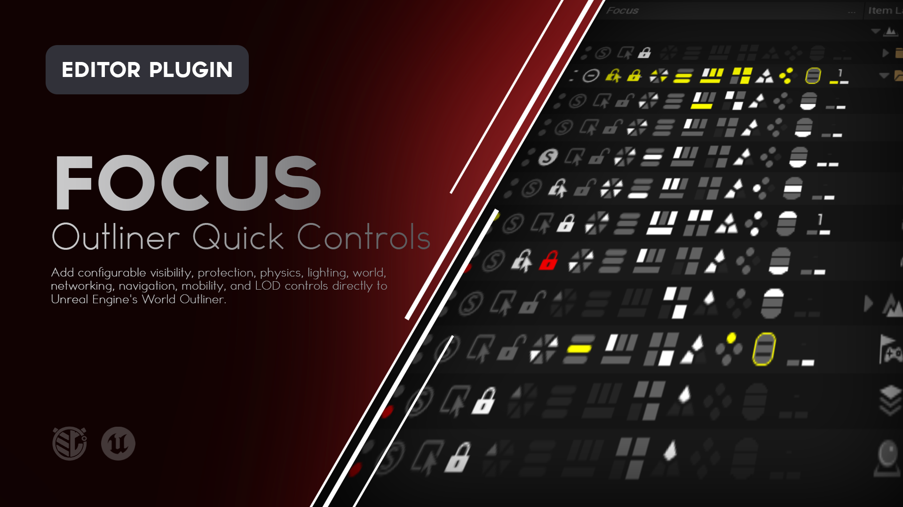

# What Is Focus? — Design

**Focus v2.1.0 | Unreal Engine 5.8.x | Windows 64-bit | Editor only**

Purpose, capabilities and scope.

## Verified behavior

Editor-only; no packaged game impact.

## Usage and workflows

# Focus

**Outliner Quick Controls**

Focus brings frequently used Actor and Component properties directly into Unreal Engine's **World Outliner**, with small, configurable, native-feeling controls. Hide or isolate Actors, protect them from accidental edits, and adjust physics, rendering, navigation, networking, world, mobility, and LOD options without opening each Actor's Details panel.

Control individual Actors or operate on supported folders, groups, attached hierarchies, and multi-selections. Focus is an **editor-only** utility, not a runtime or permissions system.

---

## What is Focus?

Focus is a compact set of **Outliner Quick Controls** for scene visibility, selection, edit protection, and frequently changed native properties. Every control lives alongside its corresponding Actor or hierarchy in Unreal Engine's World Outliner.

- Work quickly with **Hide in Editor**, **Hidden in Game**, and **Solo**.
- Prevent accidental viewport selection, Actor movement, and supported Details editing with **Selection Lock**, **Transform Lock**, and **Edit Lock**.
- Optionally expose **28 quick-property controls** across eight additional categories.
- Apply eligible operations across loaded Actors, folders, attachments, groups, and multi-selections, with Undo/Redo.
- Show only the categories you need, customize persistent and session-only colors, and decide which Visual and Interaction changes should be saved.

---

# Features

---

# How Focus Works

Focus extends Unreal Engine's World Outliner with additional editor controls.

When a Focus control is used:

1. Focus determines the Actor, Folder, Group, hierarchy, or multi-selection represented by the clicked row.
    
2. The relevant Actor scope is resolved.
    
3. Focus applies the chosen control to the affected eligible Actors or Components.
    
4. For Visual and Interaction, Focus checks that control's persistence preference. Persistent edits follow the normal save workflow; session-only edits retain the prior saved value while changing the live editor state.
    
5. Unreal's transaction system records supported changes for Undo and Redo. Persistent Actor and Component values can be stored with the affected Actor or level packages.
    

Focus protection operates entirely inside the editor.

Selection Lock and Delete/Cut protection are handled by the Focus editor mode. Transform Lock and Edit Lock use Unreal's native movement-lock behavior together with Focus's transform and property-change guards. Focus does not require the legacy editor-mode viewport-input interface, so its editor mode does not force Unreal Engine to disable Interactive Tools Framework (ITF) gizmos.

Focus does not replace or configure Unreal's transform gizmo, and its editor protections depend on the editing operation using supported engine notifications. Specialized tools can operate outside those paths, as described in **Limitations**.

Focus does not add gameplay components or runtime systems to the packaged game. Its session-only controls do not change the persistence of edits made directly through Unreal's Details panel or native Outliner commands.

---

# What Focus Does Not Do

Focus is an **editor workflow utility**, not a permissions or security system.

It does not:

- Prevent deliberate source-code changes
    
- Prevent scripts from modifying Actors
    
- Replace source control
    
- Implement user permissions
    
- Automatically check out files
    
- Prevent another developer from unlocking something
    
- Modify packaged game behavior
    
- Automatically apply Folder states to Actors added later
    

Focus is intended to prevent accidental editor interactions and make complex scenes easier to manage.

---

# Limitations

## Expected limits

Focus is an Editor-only workflow tool. Folder and selected-row changes affect eligible loaded Actors and are not automatically inherited by Actors added later. Supported native protections do not prevent arbitrary external tools or scripts.

## Related source

- [Main editor module](https://github.com/mippi-the-dork/Focus/blob/main/Source/Focus/Private/FocusModule.cpp)
- [Native quick properties](https://github.com/mippi-the-dork/Focus/blob/main/Source/Focus/Private/FocusQuickProperties.cpp)
- [Editor preferences](https://github.com/mippi-the-dork/Focus/blob/main/Source/Focus/Private/FocusSettings.h)
- [Interaction guards](https://github.com/mippi-the-dork/Focus/blob/main/Source/Focus/Private/FocusInteractionGuard.h)
- [Full README](https://github.com/mippi-the-dork/Focus/blob/main/README.md)
