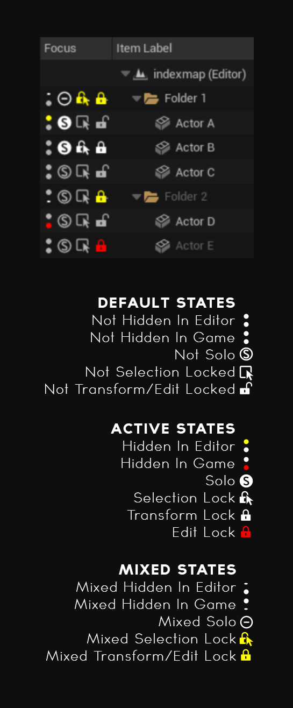
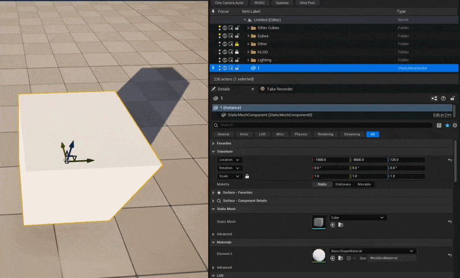

# Interaction — Design

**Focus v2.1.0 · Quick Actions · User guide**

## Choose the intended protection

| Control | Prevents in supported native editor workflows | Still allowed |
| --- | --- | --- |
| **Selection Lock** | Accidental viewport picking | Intentional selection from the Outliner |
| **Transform Lock** | Standard Actor position, rotation and scale editing | Editing unrelated properties |
| **Edit Lock** | A broader set of Actor and Component changes, including transforms | Viewing/searching Details; unlocking |

**Selection Lock** has its own toggle. The separate **Protection** micro-widget cycles **Unlocked → Transform Lock → Edit Lock → Unlocked**. It does not change Selection Lock.

## Workflow: protect finished environment pieces

1. Organize a finished section under an Outliner folder.
2. Apply **Selection Lock** to prevent accidental viewport picking while decorating nearby objects.
3. Cycle the Protection control to **Transform Lock** to protect placements but still allow a material change.
4. If the section is fully approved, cycle to **Edit Lock** for stronger protection.
5. To inspect or unlock an Actor, select it directly in the Outliner; Selection Lock deliberately does not prevent that.

## Mixed protection levels

<!-- Media target: IMAGE | interaction-mixed-protection | docs/assets/media/interaction-mixed-protection.png -->
<figure class="doc-media" data-kind="image" data-media-id="interaction-mixed-protection">
  
  <figcaption>A mixed protection state shows that eligible Actors do not currently share the same protection level.</figcaption>
</figure>

If a folder contains different protection levels, its combined control is **Mixed**. Clicking that mixed protection control makes the applicable scope **Transform Locked**, even if some members had Edit Lock. Further clicks cycle the shared level. Check the tooltip and scope before clicking a mixed folder.

## Why might a locked Actor still change?

Focus is a safeguard for supported editor interactions, **not** a security/authorization system. Scripts, custom modes and third-party tools can modify Actors through paths not covered by Focus. A viewport selection that is blocked and an Outliner selection that remains possible is the intended behavior—not a defect.

## Scope, state and saving

A row can represent one Actor or a loaded folder, attachment hierarchy, group or selection. Focus resolves eligible targets across that scope, even if Outliner children are collapsed or hidden by a search filter. **Mixed** means applicable targets disagree; **Not Applicable** means no editable matching property or control target exists. New Actors and unloaded World Partition Actors do not inherit previous bulk actions.

For the six Visual/Interaction controls, review **Editor Preferences → Plugins → Focus** for session-only persistence. The other eight Quick Actions categories change native Unreal properties using ordinary save and Undo/Redo behavior. See the [Quick Actions overview](../README.md) and [Saving guide](../../03-settings-and-saving/README.md).

For the native editor mode, Details delegates, transform and interaction guards, [read Technical](TECHNICAL.md).
