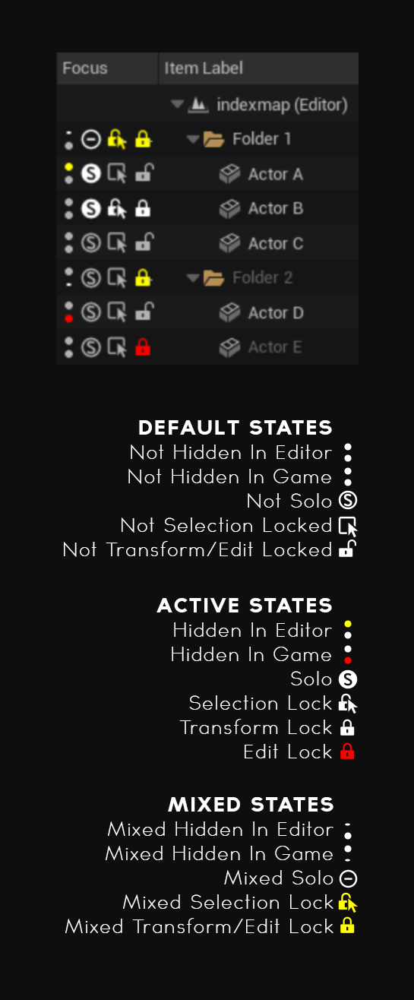
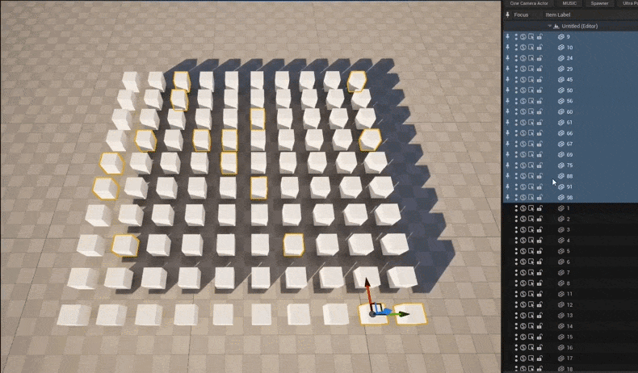

# Visual — Design

**Focus v2.1.0 · Quick Actions · User guide**

## Choose the right control

| Control | Use it when | What it does not change |
| --- | --- | --- |
| **Hide in Editor** | You want an Actor out of the way while editing | The Actor's native Hidden in Game choice |
| **Hidden in Game** | You intentionally want to configure gameplay visibility | The independent editor-hidden control |
| **Solo** | You want to see a working subset of the level | Other Actors' saved Hidden in Game flags |

Hover a control to confirm its exact purpose and current state. Click it on the relevant Actor or folder; if that row belongs to a multi-selection, the action applies to the eligible selected scope.

## Workflow: temporarily isolate a room

1. Open **Editor Preferences → Plugins → Focus**. If the isolation is only for this session, turn **Solo persistence off** before using it.
2. Find the working room's folder in the Outliner and use **Solo**.
3. Work on its loaded Actors. Solo filters **rendered primitive components** in editor views; lights and volumes may still contribute to the scene.
4. Turn off Solo or use **Restore Temporary Changes** from the Focus header menu if you made session-only edits.
5. Review the full scene before saving/publishing your level.

**Important:** Solo does not reveal an Actor that is already hidden with Hide in Editor.

## Workflow: distinguish editor and gameplay visibility

<!-- Media target: IMAGE | visual-editor-vs-game | docs/assets/media/visual-editor-vs-game.png -->
<figure class="doc-media" data-kind="image" data-media-id="visual-editor-vs-game">
  
  <figcaption>Hide in Editor changes the editing view, while Hidden in Game configures a separate native Actor property.</figcaption>
</figure>

Hide a decorative Actor in the editor, then inspect its native **Hidden in Game** value in Details: these are separate decisions. If you intend a gameplay-visible Actor to remain hidden only during editing, avoid changing Hidden in Game.

## When an action seems ineffective

- **Solo isn't fully isolated:** it filters primitives rather than suppressing every light or volume contribution.
- **The setting returns after a reload:** check whether Focus persistence was disabled and whether the Actor package was actually saved.
- **Hidden in Game won't toggle:** check for **Edit Lock** on the Actor.
- **A folder is only partly changed:** some Actors may be unloaded, newly added or outside the resolved scope.

## Scope, state and saving

A row can represent one Actor or a loaded folder, attachment hierarchy, group or selection. Focus resolves eligible targets across that scope, even if Outliner children are collapsed or hidden by a search filter. **Mixed** means applicable targets disagree; **Not Applicable** means no editable matching property or control target exists. New Actors and unloaded World Partition Actors do not inherit previous bulk actions.

For the six Visual/Interaction controls, review **Editor Preferences → Plugins → Focus** for session-only persistence. The other eight Quick Actions categories change native Unreal properties using ordinary save and Undo/Redo behavior. See the [Quick Actions overview](../README.md) and [Saving guide](../../03-settings-and-saving/README.md).

For editor rendering, state metadata and package-save implementation, [read Technical](TECHNICAL.md).
