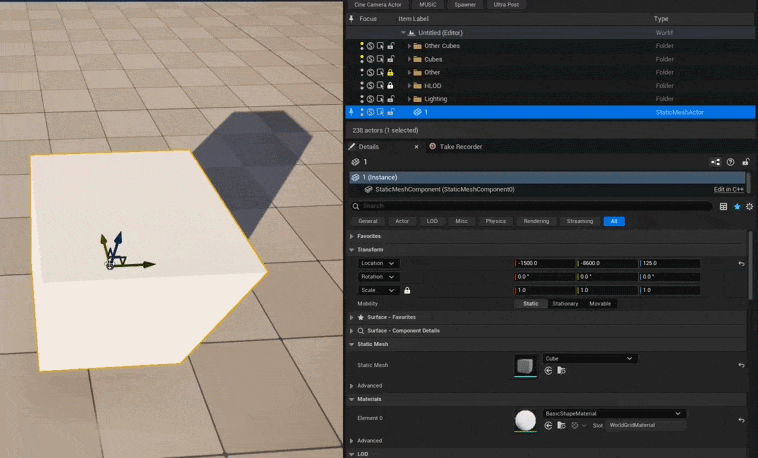

# Selection, Transform and Edit Locks — Technical

**Focus v2.1.0 | Unreal Engine 5.8.x | Windows 64-bit | Editor only**

Lock strengths and allowed editing operations.

## Verified behavior

Selection Lock allows Outliner selection. Transform Lock protects standard transforms; Edit Lock includes Transform Lock and protects supported native editing workflows. Custom scripts are not blocked.

## Protection coverage

The code has separate guards for viewport selection, transforms, Editor Details read-only state, native commands, Outliner renaming and component hierarchy edits. It preserves the original native handlers and avoids taking over a rename already in progress. Edit Lock remains an accidental-edit safeguard, not a permission system.
## Native behavior and original reference

## Selection Lock

Selection Lock prevents an Actor from being selected through the viewport.

When enabled:

- Clicking the Actor in the viewport will not select it.
    
- The Actor can still be selected from the World Outliner.
    
- Its properties can still be inspected.
    
- Selection Lock does not prevent editing by itself.
    

The **Selection Lock persistence** setting determines whether changes made through Focus are saved or session-only. With persistence off, active locks use the session-only blue palette; a Mixed state uses orange. Selection Lock does not prevent native property editing by itself.

This is useful for Actors such as:

- Large background meshes
    
- Blocking geometry
    
- Lighting Actors
    
- Reference geometry
    
- Level infrastructure
    
- Anything that frequently sits in front of what you actually want to select
    

---

## Transform Lock

Transform Lock protects an Actor's:

- Location
    
- Rotation
    
- Scale
    

Other properties remain editable.

Focus uses native Actor movement locking and a movement/transaction guard rather than replacing Unreal's viewport transform gizmo. The same Focus controls are available while using Unreal Engine's legacy or Interactive Tools Framework (ITF) gizmo system.

This is useful when an Actor is in the correct place but still needs to remain otherwise editable.

**Transform Lock and Edit Lock share one Protection Lock persistence option.** When it is off, changing the protection level through Focus remains session-only. Using Unreal's native Actor movement-lock command directly follows Unreal's normal saved behavior.

---

## Edit Lock

Edit Lock provides stronger protection.

It includes Transform Lock and protects supported Actor and Component editing operations.

This includes common workflows such as:

- Editing values in the Details panel
    
- Changing transforms
    
- Changing mobility
    
- Changing materials
    
- Renaming
    
- Deleting
    
- Cutting
    
- Changing attachments
    
- Adding Components
    
- Removing Components
    

The Actor can still be selected from the World Outliner and inspected.

You can continue to:

- Browse properties
    
- Search the Details panel
    
- Expand and collapse categories
    
- Inspect values
    
- Change Focus states
    

The purpose is to prevent accidental editing while still allowing developers to understand the Actor.

The **Protection Lock** persistence setting applies to both Transform Lock and Edit Lock. An active Edit Lock uses the **Alert** color: red when persistent or pink when session-only. Turning persistence back on keeps the current protection level, which can then be saved normally.

---

## Protection Lock States

The protection control cycles through:

```text
Unlocked → Transform Lock → Edit Lock → Unlocked
```

The visual state of the padlock indicates the current protection level. Both locked levels use the same **Protection Lock (Transform / Edit)** persistence checkbox, and the tooltip reports whether Focus changes are persistent or session-only.



## Simulation

## Verification boundary

These details are grounded in current v2.1.0 C++ source and the public README. Editor-specific combinations, such as external Actor saving and nonstandard editing modes, require validation in the target Unreal project.

## Related source

- [Main editor module](https://github.com/mippi-the-dork/Focus/blob/main/Source/Focus/Private/FocusModule.cpp)
- [Native quick properties](https://github.com/mippi-the-dork/Focus/blob/main/Source/Focus/Private/FocusQuickProperties.cpp)
- [Editor preferences](https://github.com/mippi-the-dork/Focus/blob/main/Source/Focus/Private/FocusSettings.h)
- [Interaction guards](https://github.com/mippi-the-dork/Focus/blob/main/Source/Focus/Private/FocusInteractionGuard.h)
- [Full README](https://github.com/mippi-the-dork/Focus/blob/main/README.md)
