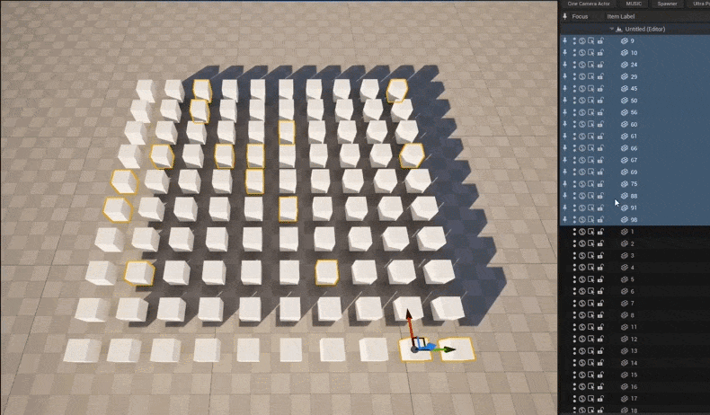

# Solo — Design

**Focus v2.1.0 | Unreal Engine 5.8.x | Windows 64-bit | Editor only**

Temporary editor viewport isolation.

## Verified behavior

Solo uses the FFocusViewExtension per-view ShowOnlyPrimitives list, not mass rewrites of Actor Hidden flags. Lights and volumes may still contribute.

## What Solo does not isolate

Solo is per editor view and filters rendered primitive scene IDs. It does not guarantee removal of light influence, volumes or other non-primitive contributions. It preserves restrictions from other view extensions by intersecting its allowed set with any preexisting ShowOnlyPrimitives mask.
## Usage and workflows

## Solo

Solo isolates part of the level inside the editor viewport.

You can Solo:

- An Actor
    
- An Actor hierarchy
    
- A Folder
    
- Multiple Actors
    
- Multiple Folders
    
- Groups
    

Multiple Solo targets can be active simultaneously.

When Solo is cleared, normal editor visibility returns.

Solo does not change Hidden in Game.

Use the **Solo persistence** checkbox to choose between saving Focus's Solo choices and keeping them temporary for the editor session. A session-only active Solo icon uses **blue** rather than white; Mixed uses **orange** rather than yellow. **Restore Temporary Changes** discards tracked temporary Solo changes along with other temporary Focus edits.

### Solo and Existing Visibility

Actors already hidden using **Hide in Editor** remain hidden while Solo is active.

Solo should be treated as a temporary viewport isolation tool rather than a replacement for normal level visibility.

Lights, volumes, and other scene systems may continue influencing the viewport even when their Actor is outside the current Solo set.

---

## Selection Lock

## Expected limits

Focus is an Editor-only workflow tool. Folder and selected-row changes affect eligible loaded Actors and are not automatically inherited by Actors added later. Supported native protections do not prevent arbitrary external tools or scripts.

## Related source

- [Main editor module](https://github.com/mippi-the-dork/Focus/blob/main/Source/Focus/Private/FocusModule.cpp)
- [Native quick properties](https://github.com/mippi-the-dork/Focus/blob/main/Source/Focus/Private/FocusQuickProperties.cpp)
- [Editor preferences](https://github.com/mippi-the-dork/Focus/blob/main/Source/Focus/Private/FocusSettings.h)
- [Interaction guards](https://github.com/mippi-the-dork/Focus/blob/main/Source/Focus/Private/FocusInteractionGuard.h)
- [Full README](https://github.com/mippi-the-dork/Focus/blob/main/README.md)
