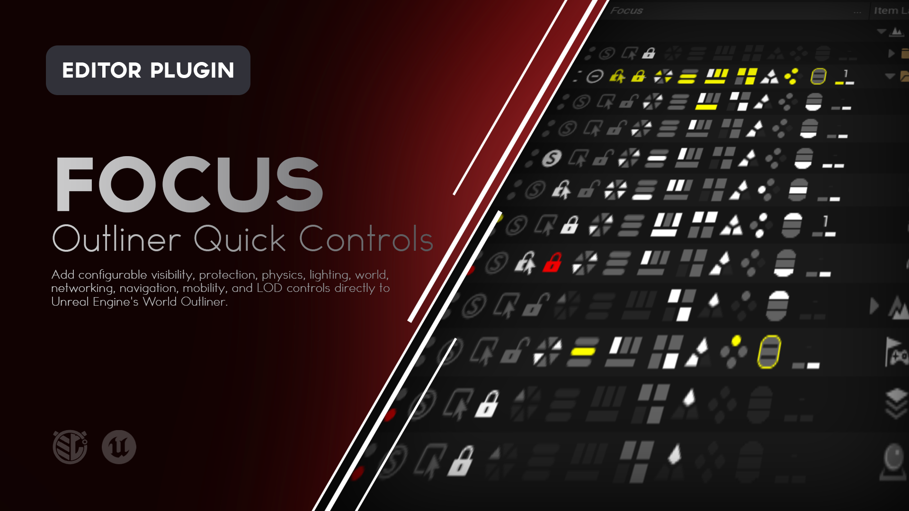

# Focus Documentation

**Focus v2.1.0 · Unreal Engine 5.8.x · Win64 · Editor-only**

Focus is a set of compact **Quick Actions for Unreal Engine's World Outliner**. It brings visibility, interaction protection and 28 native Actor/Component properties into the Outliner so you can manage the current level without repeatedly searching through Details panels.

## What can I do with Focus?

**Manage scene visibility:** Hide Actors in the editor, set Hidden in Game, or Solo part of a scene without manually hiding everything else.

**Protect your work:** Prevent accidental viewport selection, ordinary transform edits, or a broader set of supported editor property changes.

**Change native Unreal settings:** Use ten consistent Quick Action categories covering Visual, Interaction, Simulation, Physics Events, Lighting, World, Network, Navigation, Mobility and LOD.

**Work on collections:** Apply compatible actions to loaded Actor hierarchies, nested folders, groups or several selected Outliner rows. Mixed-state controls show when targets disagree.

## Get started in three steps

1. **[Install and enable Focus](01-getting-started/install/DESIGN.md)** in an Unreal Engine 5.8.x editor project on Win64.
2. **[Try your first Quick Actions](01-getting-started/first-use/DESIGN.md)** on a disposable test Actor; Visual and Interaction are already visible by default.
3. **[Explore all ten categories](02-quick-actions/README.md)** and reveal the ones you need from the Focus header menu.

## Which guide do I read?

Choose **Design** when you need to understand a control, perform a workflow or troubleshoot an expected result. Choose **Technical** when you need exact Unreal property names, eligible Actor/Component types, C++ integration, transactions or persistence behavior. Every Quick Action category has **one complete Design page and one complete Technical page**.

## Explore the manual

| Category | Topics | What you'll find |
| --- | ---: | --- |
| [01. Getting Started](01-getting-started/README.md) | 3 | Purpose, installation, first use and navigation |
| [02. Quick Actions](02-quick-actions/README.md) | 10 | One Design/Technical pair for each of the ten Focus categories |
| [03. Settings and Saving](03-settings-and-saving/README.md) | 4 | Control visibility, colors, persistence, Undo and restoration |
| [04. Workflows and Implementation](04-workflows-and-implementation/README.md) | 3 | Practical authoring, editor architecture and source ownership |
| [05. Support and Troubleshooting](05-support-and-troubleshooting/README.md) | 3 | Common questions, diagnostic steps and updating |

## Understand Focus's limits

Focus is an **editor tool**, not a packaged gameplay system or an access-control layer. Bulk actions affect **currently loaded eligible Actors**, not future folder additions or unloaded World Partition Actors. Not every property is applicable to every Actor type. The eight native quick-property categories use ordinary Unreal property saving; Focus's Visual and Interaction controls also offer optional session-only persistence.

For save behavior on shared levels, see [Session-Only and Persistent Edits](03-settings-and-saving/persistence/DESIGN.md). For protection scope, see [Interaction Quick Actions](02-quick-actions/interaction/DESIGN.md).

## What's next for Focus?

The [Focus Roadmap](ROADMAP.md) traces **v1.0** (Visual and Interaction), **v2.0** (eight additional categories and optional session-only Visual/Interaction changes), and **v3.0 (planned)**: new Quick Action categories, an API for other plugins and a Quick Widget Builder.

These are **planned features**, not capabilities in Focus v2.1.0. The [documentation audit](DOCUMENTATION_AUDIT.md) tracks improvements and remaining gaps. The [verification matrix](VERIFICATION_MATRIX.md) defines tests awaiting real editor/browser results.

## Project and support

- [Focus source repository](https://github.com/mippi-the-dork/Focus)
- [Releases](https://github.com/mippi-the-dork/Focus/releases)
- [Report an issue](https://github.com/mippi-the-dork/Focus/issues)

**Documentation basis:** Focus v2.1.0 public C++ source and README. Technical behavior has been source-reviewed; comprehensive in-editor cross-project testing is not claimed complete.
